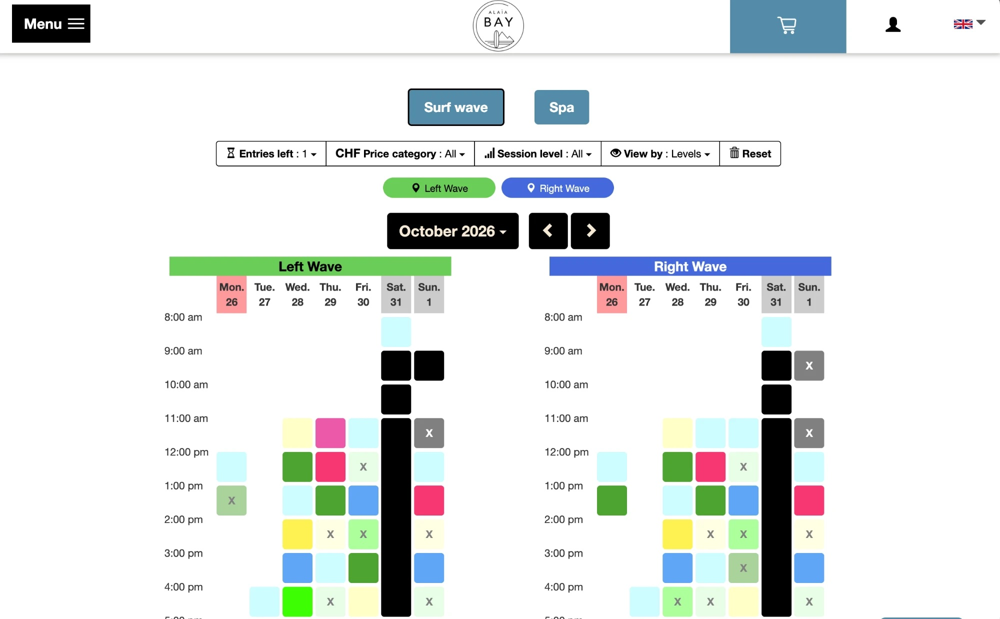
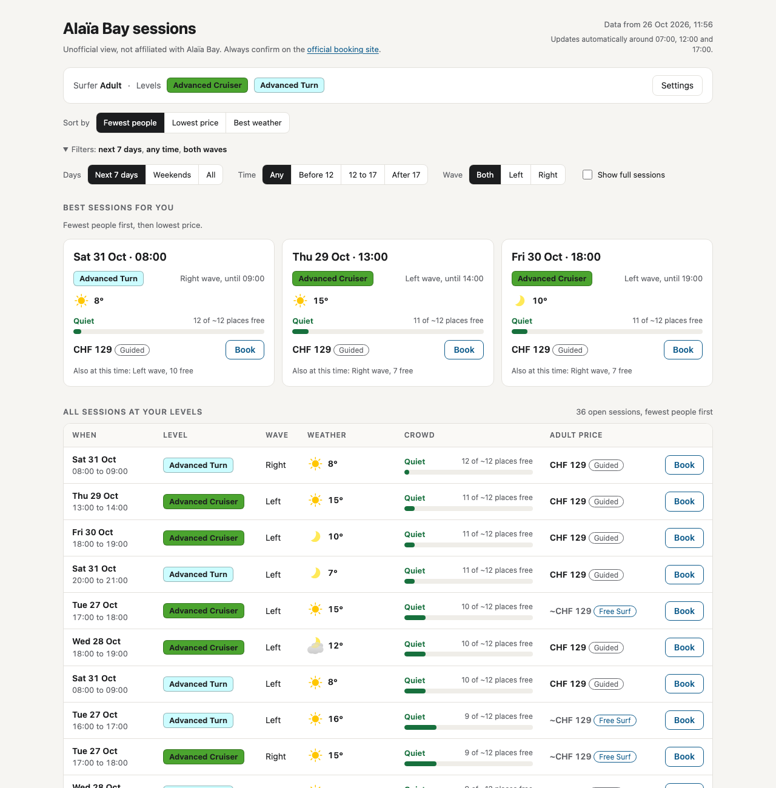
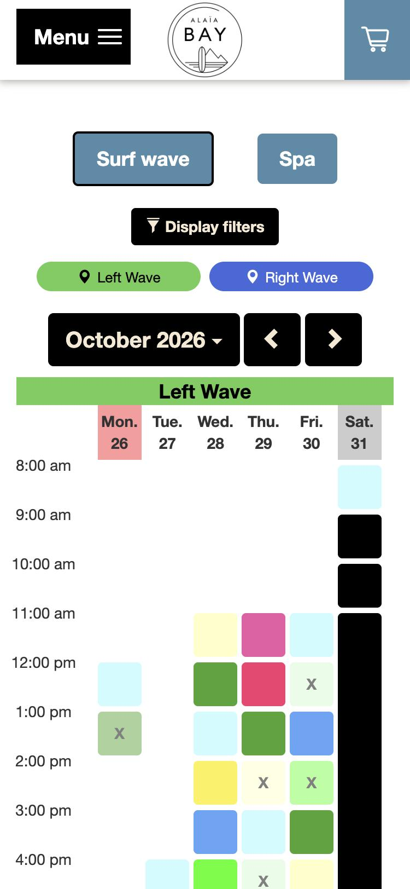
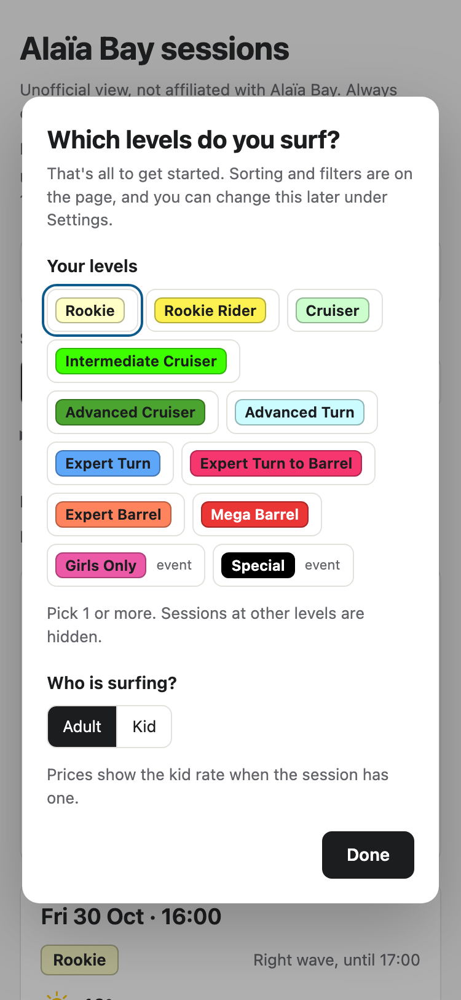
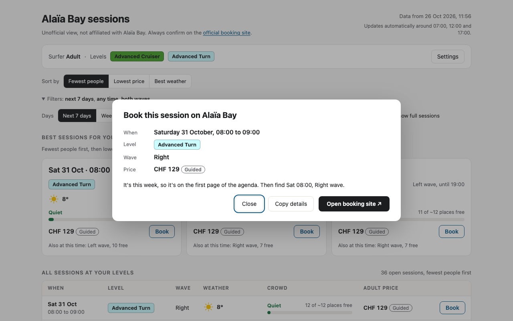

# Alaïa Bay sessions

**Find the right surf session at Alaïa Bay in 1 screen: your levels, ranked by crowd, price or weather.**

[Open the live page](https://sofianbettayeb.github.io/alaia-sessions/) · Updated 3 times a day

> [!NOTE]
> Unofficial personal tool, not made, run or endorsed by Alaïa Bay. Booking always happens on the [official booking site](https://booking.alaiabay.ch/activity-agenda).

## At a glance

| | Official agenda | This view |
|---|---|---|
| Your levels | Every level shown, matched by colour or a filter | Picked once, remembered |
| Order | Time grid | Fewest people, lowest price or best weather |
| Weather | None | MeteoSwiss forecast for each session's hour |
| Places left | Behind a click on each slot | Shown for every session, with a crowd estimate |
| Price | Behind a click on each slot | Shown for every session |
| Range | 1 week per page | 2 weeks |
| Phone | Grid cut off on the right | Session cards |

## Before and after

### Desktop

**Official agenda.** A colour-coded grid per wave. Each colour is a level, explained in a legend under the grid, and an X means full.



**This view.** Only your levels, in the order you chose, with weather, places left and price on every row.



### Phone

<table>
  <tr>
    <th>Official agenda</th>
    <th>This view</th>
  </tr>
  <tr>
    <td></td>
    <td></td>
  </tr>
</table>

Both captured on 26 October 2026.

## What changes when you look for a session

### 1. You set your levels once

The official agenda shows every level, so you either match colours against the legend or set its level filter. Here you pick your levels on your first visit, along with Adult or Kid. Your browser remembers them, and every other level stays hidden.



### 2. Sessions come in the order that matters to you

On a time grid, finding the quietest or cheapest session means opening slots one by one. Here, **Sort by** ranks every session:

| Sort by | Order |
|---|---|
| Fewest people | Least booked first, then cheapest |
| Lowest price | Cheapest first, then least booked |
| Best weather | Lowest chance of rain, then warmest |

The top 3 appear as cards, 1 per start time, and the full list below follows the same order. Preferred days, set in Settings, always come first. Filters narrow the list by days, time of day and wave.

For example, on 26 October, for Advanced Cruiser and Advanced Turn, **Lowest price** put the 4 CHF 89 deal sessions of Sunday 1 November at the top.

### 3. The weather sits next to every session

The wave is outdoors, and the official agenda has no weather. Without this page you open MeteoSwiss in another tab and line up the hours yourself. Here each session shows the forecast for its hour: an icon and the temperature, plus a warning when rain is 30% likely or more, or when the wind reaches 20 km/h. **Best weather** turns that into a ranking.

### 4. You see what the agenda keeps behind a click

The booking site's data holds more than its grid shows. For every session, this page shows:

- **Places left.** The official site keeps them in a hidden field of each slot's booking popup, and its "Entries left" filter only hides slots below a number. This page shows the number and turns it into a crowd estimate: Quiet, Moderate or Busy.
- **Price and session type** (Guided, Coached, Deal). The official site shows these only after you click a slot. When a slot lists no price at all, its popup says "No products are available for this time slot!", and this page shows the usual price for that level, marked `~CHF`.
- **2 weeks**, instead of 1 week per page.

### 5. Booking still happens on Alaïa Bay

The booking site has no link to a single session, because it picks the agenda week from a server-side session. So **Book** opens a summary of the session, says which week of the agenda to open, and offers **Copy details** and **Open booking site**.



## How it works

| File | What it does |
|---|---|
| `scrape_agenda.py` | Replays the agenda's own requests and opens each slot's booking popup to read places left and prices. Writes `agenda.json`. |
| `fetch_forecast.py` | Reads the [MeteoSwiss open data](https://opendatadocs.meteoswiss.ch/e-forecast-data/e4-local-forecast-data) local forecast for Sion (postal code 1950), the same forecast the MeteoSwiss app shows. Writes `forecast.json`. |
| `build_view.py` | Combines `agenda.json`, `forecast.json` and `view_template.html` into `index.html`, a single static page. |
| `.github/workflows/refresh.yml` | Reruns all 3 around 07:00, 12:00 and 17:00 Swiss time and commits the result. GitHub Pages serves `index.html`. |

If MeteoSwiss is unavailable, the last forecast is kept and the sessions still update.

## Methodology

### Crowd

The booking popup gives the places left for each slot, but not the capacity. Capacity is estimated as the most places ever seen free for that level, with a minimum of 12. "Booked" is capacity minus places left.

| Booked | Label |
|---|---|
| Under 40% | Quiet |
| 40% to 75% | Moderate |
| Over 75% | Busy |
| 0 places left | Full |

### Price

The price is the slot's adult product, or its kid product when the surfer is set to Kid and the slot has one. In Kid mode, a slot with no kid rate is tagged "Adult rate". When a slot lists no products, the page shows the most common listed price for that level, marked `~CHF`.

### Weather

- MeteoSwiss publishes 1 CSV per parameter for every Swiss postal code, updated hourly and covering 8 days. Only the Sion rows are kept, and UTC times are converted to Swiss time.
- Each session reads the hourly values stamped at the end of its hour: a 16:00 to 17:00 session uses the 17:00 values.
- **Best weather** compares the chance of rain in steps of 10%, then the temperature. When every session is dry, the page says it is ranking by warmth.
- Sessions past the forecast, about 7 days out, show "No forecast yet" and go last under **Best weather**.

## Design review

On 26 October 2026 the page went through the Impeccable `critique` command: a design review and an automated detector, run separately and then combined. It scored **26/40** on Nielsen's 10 usability heuristics. The 5 priority issues were fixed in `7b4efcb` and `f3ff6c4`.

| Severity | Issue | Fix |
|---|---|---|
| P0 | On a phone the session table scrolled sideways: 861px of content on a 375px screen. | Below 920px each session becomes a compact card. |
| P1 | **Book** opened the generic agenda, so the session details had to be remembered across sites. | **Book** opens a summary with the week to open and a copy button. |
| P1 | The first visit was a form with 8 controls that opened with a red error. | The first visit asks only for levels and Adult or Kid. Sorting and filters moved onto the page. |
| P1 | White text on the green Advanced Cruiser label was 3.2:1, below the 4.5:1 minimum. | Each level label uses whichever text colour contrasts more: 5.3:1 on that green. |
| P2 | 2 of the 3 best sessions were often the Left and Right wave of the same hour. | 1 card per start time, naming the other wave. |

## Run it locally

```bash
python3 serve.py
```

Then open http://localhost:4322/. Locally the page has a **Refresh data** button that reruns the scraper and the forecast in about 1 minute.
