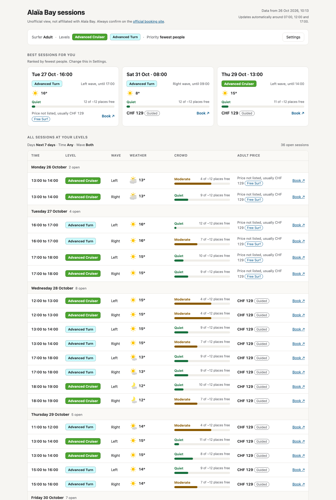
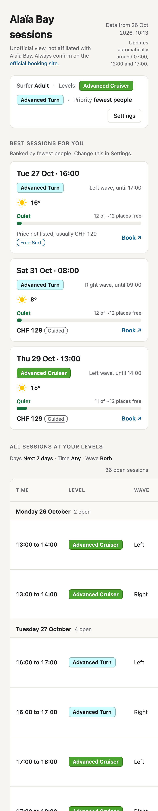
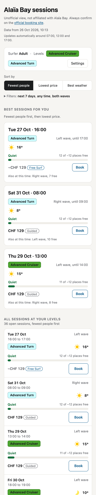
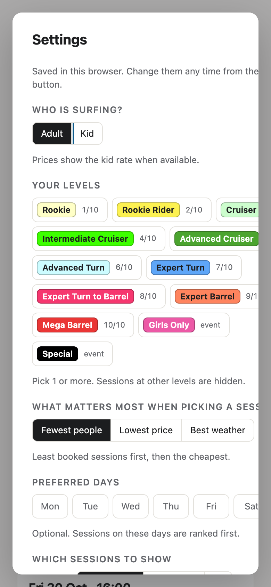
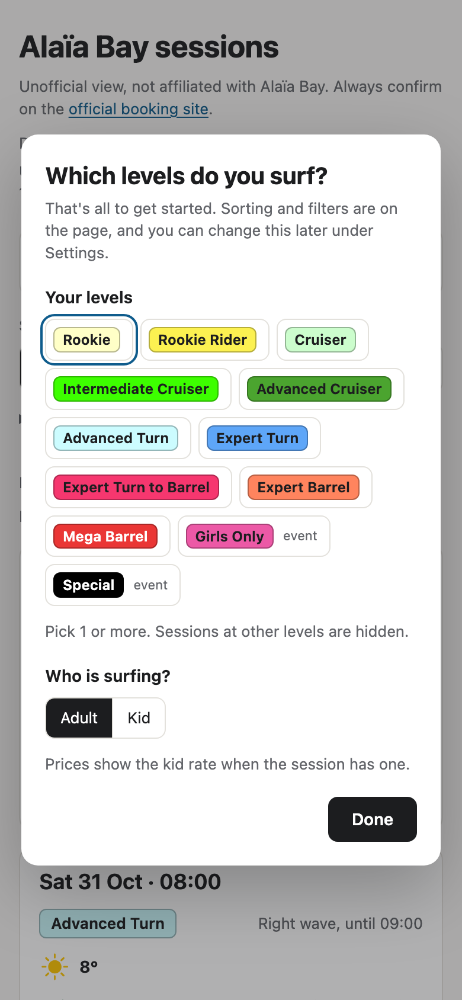

# Alaïa Bay sessions (unofficial)

An unofficial, easier-to-read view of the [Alaïa Bay](https://booking.alaiabay.ch/activity-agenda) surf session calendar. It is not made, run or endorsed by Alaïa Bay. Always confirm and book on the official booking site.

Live page: https://sofianbettayeb.github.io/alaia-sessions/

For each session it shows the level, how booked it is, the price and the weather forecast for that hour. It ranks the best sessions for your levels by fewest people, lowest price or best weather. Your settings stay in your own browser.


## How it works

- `scrape_agenda.py` reads the public agenda and each slot's booking popup (places left, prices) and writes `agenda.json`.
- `fetch_forecast.py` reads the [MeteoSwiss open data](https://opendatadocs.meteoswiss.ch/e-forecast-data/e4-local-forecast-data) local forecast for Sion (postal code 1950), the same forecast the MeteoSwiss app shows, and writes `forecast.json`: 1 summary per day plus hourly temperature, rain chance and wind.
- `build_view.py` turns `agenda.json`, `forecast.json` and `view_template.html` into `index.html`, a single static page.
- A GitHub Actions workflow (`.github/workflows/refresh.yml`) reruns all 3 around 07:00, 12:00 and 17:00 Swiss time and commits the result. GitHub Pages serves `index.html`. If MeteoSwiss is unavailable, the last forecast is kept and the sessions still update.

## Methodology

### Crowd

The booking popup gives the places left for each slot, but not the capacity. Capacity is estimated as the most places ever seen free for that level, with a minimum of 12. "Booked" is then capacity minus places left:

| Booked | Label |
|---|---|
| Under 40% | Quiet |
| 40% to 75% | Moderate |
| Over 75% | Busy |
| 0 places left | Full |

### Price

The price is the adult product of the slot (or the kid product when the surfer is set to Kid and the slot has one). When a slot lists no products, the page shows the usual price for that level, marked `~CHF`. The usual price is the most common listed price for that level. Tags come from the product name: "Deal" for a reduced price, then 1 session type (Coached, Guided, or "Coached or guided").

### Weather

MeteoSwiss publishes 1 CSV per parameter for every Swiss postal code, updated hourly and covering 8 days. Only the Sion rows are kept. Times in the files are UTC and are converted to Swiss time.

- **Each session** reads the hourly values stamped at the end of its hour: a 16:00 to 17:00 session uses the 17:00 values. It shows the MeteoSwiss icon and the temperature. It adds "Rain X%" when the chance of rain is 30% or more, and "Wind X km/h" when the mean wind is 20 km/h or more.
- **Sessions past the forecast** (about 7 days out) show "No forecast yet".

### Ranking

"Sort by" orders both the 3 best sessions and the full list. Preferred days (set in Settings) always come first. Within them:

| Sort by | Order |
|---|---|
| Fewest people | Least booked, then cheapest |
| Lowest price | Cheapest, then least booked |
| Best weather | Lowest chance of rain (in steps of 10%), then warmest, then least booked. When every session is dry, the page says it is ranking by warmth. Sessions past the forecast come last. |

The 3 best sessions show 1 card per start time. If the other wave is also open at that time, the card says so ("Also at this time: Right wave, 7 free"). Full sessions are hidden unless "Show full sessions" is on, and then they go last.

### Booking

The booking site has no link to a single slot: it picks the agenda week from a server-side session. So "Book" opens a panel with the date, time, level, wave and price, says which week of the agenda to open, and offers "Copy details" and "Open booking site".

## Design review, 26 October 2026

The page was reviewed with the Impeccable `critique` command: a design review and an automated detector, run separately, then combined. It scored **26/40** on Nielsen's 10 usability heuristics (Acceptable). It found 5 priority issues, all fixed in commits `7b4efcb` and `f3ff6c4`:

| Severity | Issue | Fix |
|---|---|---|
| P0 | On a phone the session table scrolled sideways (861px of content in a 375px screen), and Weather, Crowd, Price and Book were off-screen. | Below 920px each session becomes a compact card. Nothing scrolls sideways at 375px. |
| P1 | "Book" opened the generic agenda, so the date, time, level and wave had to be remembered across sites. | "Book" opens a panel with the slot details, which week to open, and a copy button. |
| P1 | The first visit was a long form (8 controls) that opened with a red error before anything was clicked. | The first visit asks only for levels and Adult or Kid. Sort and filters moved onto the page. The error only shows if Done is pressed with no level. |
| P1 | White text on the green "Advanced Cruiser" pill was 3.2:1, below the 4.5:1 minimum. | Each pill now uses whichever text colour, white or dark, contrasts more (5.3:1 on that green). |
| P2 | 2 of the 3 best sessions were often the Left and Right wave of the same hour, and "Best weather" looked like it did nothing in a dry week. | 1 card per start time, and the ranking line explains when it is ranking by warmth. |

Smaller fixes from the same review:
- Pick cards have headings, and the Book column has a name for screen readers.
- Selected levels show a tick and a stronger border.
- Rain and wind notes are amber instead of link blue.
- The browser tab title matches the page heading.
- Kid mode tags sessions with no kid rate as "Adult rate".
- "Sort by" now orders the full list, with the date on each row. Before, only the 3 picks changed.

### Before and after

Both versions are rendered from the same data (26 October 2026, 10:13), with the levels Advanced Cruiser and Advanced Turn and "Fewest people" selected.

**Desktop**

| Before | After |
|---|---|
|  |  |

**Phone (390px wide)**

| Before | After |
|---|---|
|  |  |

**First visit on a phone**

| Before | After |
|---|---|
|  |  |

**Booking panel (new)**


## Run it locally

```bash
python3 serve.py
```

Then open http://localhost:4322/. Locally the page has a "Refresh data" button that reruns the scraper and the forecast (about 1 minute).
